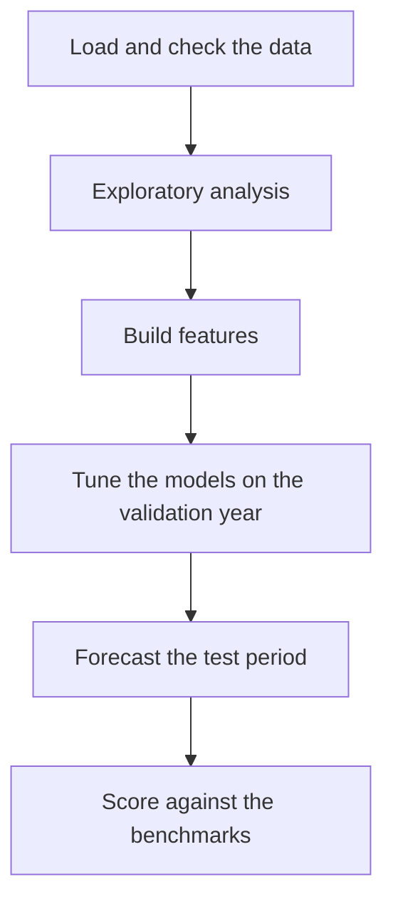

# Bluegrid Task

Forecasts the 24 hourly values of A for day T from information available before
12:11 on day T-1. The method and the results are described in [REPORT.pdf](REPORT.pdf).

## How to Run this Project

Requires Python 3.14 (not tested on older versions).   
Package versions are pinned in `pyproject.toml` to the ones the reported results were produced with.  

Open a terminal, move into the project folder (the one with `pyproject.toml`)
and install from there (Windows PowerShell):

```powershell
cd bluegrid-task
python -m venv .venv
.\.venv\Scripts\python.exe -m pip install .
.\.venv\Scripts\python.exe run.py
```

On Linux/macOS use `.venv/bin/python` instead of `.\.venv\Scripts\python.exe`.
If you want to change the code in `forecast/` and have the changes picked up
without reinstalling, install with `pip install -e .` instead.

`run.py` does everything from the raw data to the final numbers: data checks,
exploratory analysis, features, tuning on the validation year, the test run and
the comparison with the published benchmark. Progress is printed as it goes.  

A full run took about 33 minutes on a laptop with an AMD Ryzen 9 8945HS
(8 cores, 16 threads) and 32 GB of RAM, on Windows 11.

## Flow Chart



## Inputs

```text
data/
├── podatki.csv                the hourly data: A, N_1, N_2
├── lago_DE.csv                German dataset published with Lago et al. (2021); the run checks ours is identical to it
└── lago_forecasts_DE.csv      their published forecasts, used only to score them next to ours
```

`lago_DE.csv` comes from [Zenodo](https://zenodo.org/records/4624805) and
`lago_forecasts_DE.csv` from the
[epftoolbox repository](https://github.com/jeslago/epftoolbox/tree/master/forecasts).

## Outputs

```text
results/
├── eda/
│   ├── EDA.md                 exploratory report, from data before the test period only
│   ├── eda.json               all EDA tables, machine-readable
│   └── figures/*.png          the report's figures
├── results.json               every number of the run: split dates, dropped features, validation
│                              trials, chosen settings and the test metrics of every forecast
├── predictions.csv            test-period forecasts of every model next to the actual values
└── error_by_hour.png          test MAE by hour of day
```

## Code

```text
├── run.py                     the pipeline, the candidate settings and the output paths
├── forecast/
│   ├── dataset.py             loading, data checks, train / validation / test split
│   ├── eda.py                 exploratory tables and figures
│   ├── features.py            feature table and correlation filter
│   ├── models.py              target transform and the three models
│   ├── walk_forward.py        walk-forward refitting and forecasting
│   └── metrics.py             naive benchmarks and error measures
└── tests/
    └── test_pipeline.py       tests of the features and the error measures, see below
```

## Tests

The tests guard what the reported results depend on:

- **No information from the future.** Neither the features of a day nor the
  model fitted for it change when values that are not yet known at forecast time are altered.
- **Correct units.** The target transform is undone exactly by its inverse.
- **Correct benchmark.** The naive forecast scores an rMAE of exactly 1 against itself.

They use small generated data, so they take a few seconds and need neither
`data/podatki.csv` nor a finished run.

Run it with:
```powershell
.\.venv\Scripts\python.exe -m pytest tests
```