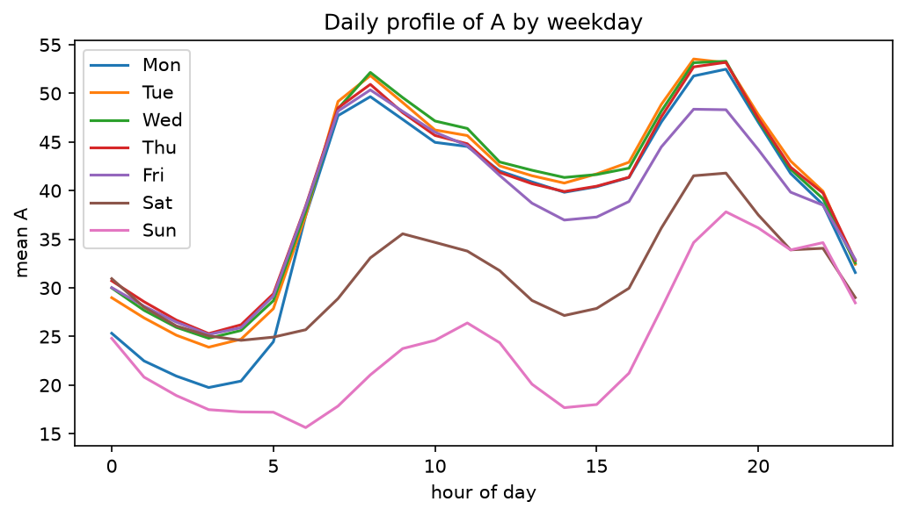
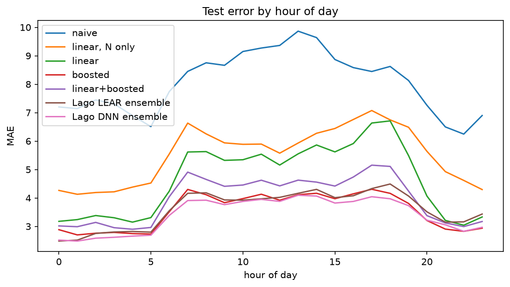

# Forecast of A

## Management summary

The task was to forecast, before 12:11 each day, the 24 hourly values of A for the next day from two known drivers, N_1 and N_2. I built a model that does this using only information available at that moment, and tested it on two full years of data that played no part in building it.

The recommended model, gradient-boosted trees refitted every day, has an average error of **3.54** units per hour. Simply repeating recent values gives 8.04, so the model removes **56 %** of that error. The data turned out to be a public research benchmark of German day-ahead power prices, which provides an independent yardstick: on the same data and test period, the two reference models published with that benchmark reach 3.61 and 3.41. My model is on par with them, although it is a single model, while each of theirs combines four. Like them, it uses only the data in the provided file.

Its weakness is extreme hours: in the 5 % of hours with the highest values, the error is three times the average. Its settings were chosen on the average error, which suits trading the normal profile of every day. A strategy built on catching unusual days would need it selected differently (section 6). Every result in this report comes from one run of the delivered code.

## 1. What is known at forecast time

The forecast for day T is made on day T-1 before 12:11. By then A is known up to 23:00 of day T-1, because those values were fixed at 12:11 on day T-2. N_1 and N_2 are known up to 23:00 of day T. The code keeps to this in two places:

- **Inputs.** For each hour of day T the model is given N_1 and N_2 of day T, but A only from day T-1 or earlier.
- **Training.** The model that forecasts day T is fitted only on days before T. Its settings were chosen on the validation year, before the test period starts.

For example, Wednesday's forecast is made on Tuesday before 12:11. It uses N_1 and N_2 for Wednesday, A up to Tuesday 23:00, and a model fitted on data up to Tuesday 23:00.

Two automated tests enforce this. They alter every value that would not yet be known and check that neither the inputs nor the forecast of day T change.

## 2. The data and where it comes from

The file holds 52,416 hourly rows from 2012-01-09 to 2017-12-31, with no missing or duplicated hours. Data this clean and regular is unusual for an operational source, so I suspected a public benchmark set and searched for it. It is, row for row, the German dataset of Lago et al. (2021), "Forecasting day-ahead electricity prices: A review of state-of-the-art algorithms, best practices and an open-access benchmark" (Applied Energy 293). A is the day-ahead power price, N_1 a load forecast and N_2 the wind and solar generation forecast. The code checks the match on every run.

To my knowledge that study is still the standard reference for this problem, and its authors publish their forecasts. I used it in two ways:

- **As a yardstick.** I adopted its split and scored the published forecasts with my own code, so the comparison in section 6 is like for like. The models themselves use only the provided file; no other data was used.
- **Not as a recipe.** I chose the models for what the data needs, not to rebuild the study's. One of mine, a linear regression per hour, is similar to the study's linear model. I kept it because it fits the problem and can extrapolate beyond the values seen in training. Where I deviate is in the rest. Prices do not respond linearly at the edges: they jump in steps when supply is nearly exhausted and collapse, even below zero, when there is too much of it. So I added tree models, which can follow such steps, and I used a small, explainable set of features in place of the study's large set of lagged hourly inputs.

| Period | Dates | Use |
|---|---|---|
| Train | 2012-01-09 to 2015-01-04 | fitting, feature filter |
| Validation | 2015-01-05 to 2016-01-03 | choosing settings |
| Test | 2016-01-04 to 2017-12-31 | one final run |

## 3. Exploratory analysis

Before choosing features and models I needed to know how A is distributed, what repeats, what drives it and whether the past resembles the future. Only data before the test period was used. The full analysis, with all tables and figures, is in [results/eda/EDA.md](results/eda/EDA.md); the table below gives what mattered. Each answer led to one design decision:

| Question | Finding | Decision |
|---|---|---|
| How is A distributed? | Heavy tails: from -222 to 210 around a median of 35; 0.9 % of hours are zero or negative; kurtosis 19.9 | Transform A before fitting (section 5) |
| What repeats? | Over the day the average of A moves from 23.1 at 03:00 to 48.6 at 19:00; weekdays average 38 to 40, Saturday 31, Sunday 24 | Hour and weekday as inputs; A of yesterday and of last week as features |
| What drives it? | N_1 - N_2 is the best single driver (rank correlation 0.72); in the scatter plot the relation bends at both ends | Use the difference as a feature; allow non-linear models |
| Is it stable? | No. The yearly mean of N_1 - N_2 fell from 14,622 (2012) to 8,887 (2015), and A from 42.9 to 31.6 | Train on recent data and refit often |
| What must a model beat? | "Yesterday for Tuesday to Friday, last week for Saturday to Monday" has an MAE of 7.54, against 8.76 for yesterday alone and 8.83 for last week alone | Use it as the naive baseline; it is also the one used in the literature |

## 4. Features

Nineteen features per hour. Each group answers one question the model needs answered:

| Group | Features | Why |
|---|---|---|
| Drivers on day T | N_1, N_2, N_1 - N_2, N_2 / N_1, daily mean of N_1 - N_2 | The level A is set against, for the hour and for the day as a whole |
| Change in drivers | N_1 - N_2 against yesterday and last week; N_1 and N_2 relative to their 4-week average for the same weekday and hour | How day T differs from days whose A is already known |
| Recent A | same hour 1, 2 and 7 days ago; mean, minimum and maximum of yesterday | The latest level and shape of A, following the daily and weekly repetition |
| Was yesterday unusual | yesterday's A minus its 7-day average, and minus its 4-week same-weekday average | Lets the model discount a one-off spike instead of carrying it forward |
| Calendar | hour, weekday | The daily and weekly pattern |

Ratios are used only for N_1 and N_2, which are always positive. A crosses zero, so it enters as levels and differences. Of any two features with a rank correlation above 0.95 on the training period, the one less related to A is dropped. This removed N_2, whose information remains in the difference and the ratio.

## 5. Models

**Preparing A.** The spikes and negative values of A would dominate any fit. So before fitting, A is centred on its median, scaled by its median absolute deviation and passed through asinh. That function is linear near zero and logarithmic in the tails, so it dampens spikes like a logarithm but also works for negative values. It reduces the kurtosis of A from 19.9 to -0.5. Every forecast is converted back to the original units.

**Three models.** I compared three, each chosen for what it does well:

| Model | What it is | Why | Known weakness |
|---|---|---|---|
| Linear | One LASSO regression for each hour of the day | Simple and explainable. One regression per hour, because the drivers act differently at night and at peak. It keeps responding when the drivers move beyond the values seen in training, which matters because the data drifts | Cannot follow bends and steps |
| Boosted trees | One XGBoost model for all hours, with the hour as an input | Learns bends, steps and interactions from the data without being told their shape | Beyond the values seen in training its forecast stays flat |
| Linear + boosted | The linear model, plus trees trained on its errors | Meant to combine the two: the linear part for reach, the trees for shape | Its forecast is built on the linear one, so large linear misses carry over |

**How they are run.** Each model is refitted as time moves forward, as it would be in operation: for every forecast day it is fitted only on the days before it. These options were tried on the validation year:

| Choice | Options tried |
|---|---|
| Training window | last 364 days, last 728 days, all history |
| Refit | weekly, daily |
| LASSO penalty (linear model) | 0.001, 0.003, 0.01, 0.03 |
| Tree depth (boosted trees) | 3, 6 |

The best option for each model was then frozen. The outcome:

| Model | Training window | Refit | Validation MAE |
|---|---|---|---|
| Linear | last 364 days | daily | 3.51 |
| Boosted trees | last 728 days | daily | 3.45 |
| Linear + boosted | last 728 days | daily | 3.50 |

Training on all history was never the best choice, which confirms the drift. Refitting daily instead of weekly improved every model by about 1 %.

## 6. Results and comparison with the published benchmark

The forecasts are scored on the test period with several measures, because no single number describes a forecast. **MAE** is the average size of a miss in units of A. It is the main measure: it is easy to read, every hour counts the same, and the settings were chosen on it. **RMSE** squares the misses before averaging, so a few very bad hours raise it sharply. A forecast with a good MAE and a poor RMSE is usually right but occasionally far off. **rMAE** is the MAE divided by the MAE of the naive forecast, so it shows what a model adds over simply repeating recent values; below 1 is better than naive. **Bias** is the average of forecast minus actual. It shows direction, not size: positive means the forecast is too high on average, negative too low. The last two columns are the MAE in the hours where A was among its **lowest 5 %** and its **highest 5 %**. They show how a forecast does on the extreme hours, which the overall average hides.

| Forecast | MAE | RMSE | rMAE | Bias | MAE low 5 % | MAE high 5 % |
|---|---|---|---|---|---|---|
| Naive | 8.04 | 13.87 | 1.00 | -0.02 | 24.41 | 16.03 |
| Linear, N_1 and N_2 only | 5.53 | 8.70 | 0.69 | -0.89 | 11.24 | 19.02 |
| Linear | 4.66 | 13.50 | 0.58 | 0.66 | 13.03 | 24.37 |
| **Boosted trees** | **3.54** | **6.05** | **0.44** | -0.35 | 9.52 | 10.59 |
| Linear + boosted | 3.96 | 8.23 | 0.49 | 0.16 | 10.55 | 14.90 |
| *Published: LEAR ensemble* | 3.61 | 6.51 | 0.45 | -0.08 | 11.94 | 10.67 |
| *Published: DNN ensemble* | 3.41 | 5.93 | 0.42 | -0.27 | 8.83 | 9.82 |

- **Boosted trees are the model to use.** They were the best of my models on the validation year and stayed the best on the test period.
- **They are on par with the published models.** Their MAE is 2 % below the published linear ensemble and 4 % above the neural-network ensemble. Each of those combines four models; mine is a single model. I did not test whether the differences are statistically significant, so they should be read as "on par", not as a ranking.
- **The features matter.** "Linear, N_1 and N_2 only" is a reference run, not a fourth model: the linear model with its chosen settings, given only N_1, N_2, the hour and the weekday instead of the features of section 4. Its MAE is 5.53, against 4.66 with the features.
- **The linear model failed on extreme hours,** the opposite of what I expected. On an ordinary hour it is fine: its median error is 2.46, against 2.30 for the trees. But its worst miss is 424 units, against 115 for the trees. The likely cause is the conversion back to original units, which grows exponentially in the tails, so a forecast slightly too high on the transformed scale becomes far too high. The combined model, built on the linear one, also has large misses: its worst is 179 units.
- **2017 was harder than 2016.** The MAE of the trees is 3.08 in 2016 and 3.99 in 2017; for the published linear ensemble it is 2.96 and 4.25.

### Which measure matters depends on what is traded

**Trading every day, on the normal profile of A:** a miss costs in proportion to its size, so MAE is the measure to look at. This is the use the model was selected for: its settings were chosen on MAE, and it is fitted on the transformed A, which dampens the spikes.

**Trading the unusual days, the spikes and the very low values:** large misses cost the most, so RMSE and the two tail columns are the measures to look at. Every forecast does worse on these hours, because they are chosen for having extreme actual values: the trees' error is 9.52 in the lowest 5 % and 10.59 in the highest 5 %, about three times their average, and roughly the same for both published ensembles (2.6 to 3.3 times). Measured against the alternatives, the trees are the best of my models on the tails and on par with the published ones (LEAR 11.94 / 10.67, DNN 8.83 / 9.82).

