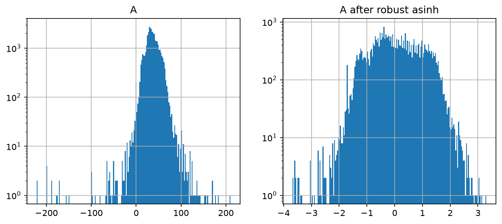
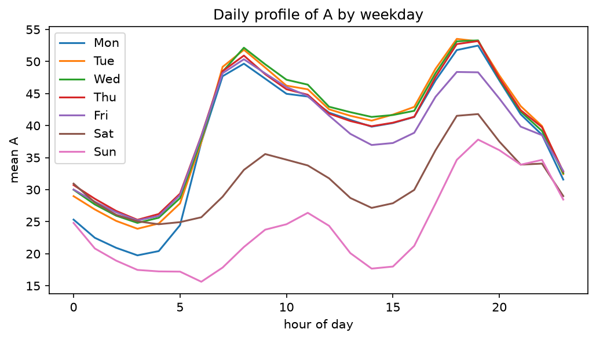
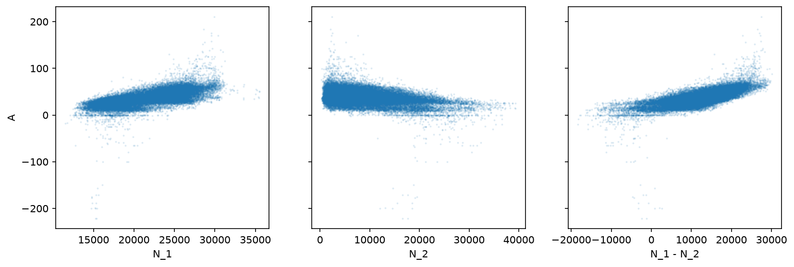
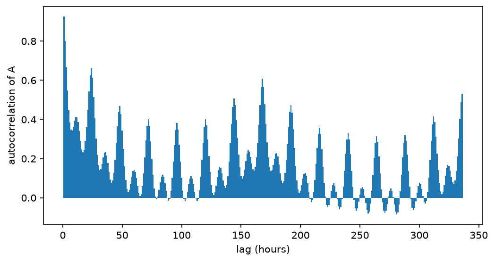
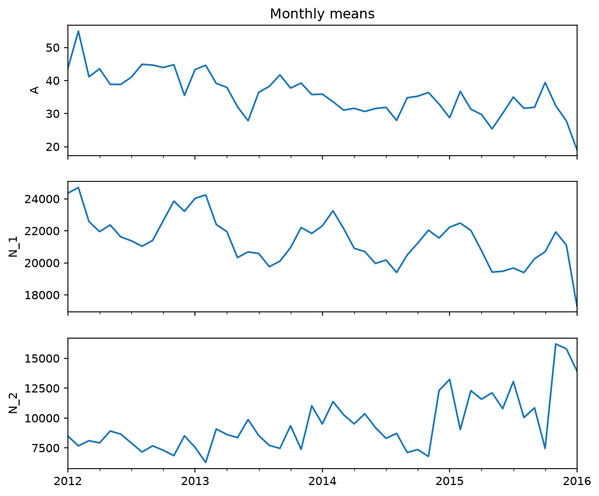

# Exploratory analysis

Data from 2012-01-09 to 2016-01-03 (34,944 hourly rows). The test period is not part of this analysis. All tables are also in [eda.json](eda.json).

## Distribution

How wide are the tails, and does A go to zero or below?

|     |   count |      mean |      std |       min |        1% |      50% |       99% |     max |   skew |   kurtosis |   share<=0 |
|:----|--------:|----------:|---------:|----------:|----------:|---------:|----------:|--------:|-------:|-----------:|-----------:|
| A   |   34944 |    36.198 |   15.946 |  -221.99  |     0.07  |    34.97 |    74.206 |   210   | -0.83  |     19.927 |      0.009 |
| N_1 |   34944 | 21499.9   | 3844.86  | 11508     | 14246.2   | 21432.5  | 29714.5   | 35499.2 |  0.092 |     -0.871 |      0     |
| N_2 |   34944 |  9388.92  | 6734.88  |   302.238 |   871.166 |  7708.81 | 29204.1   | 39344.7 |  0.977 |      0.532 |      0     |

## Effect of the asinh transform on A

Does the target transform remove the skew and the heavy tails? Counts are on a log scale.

|              |   skew |   kurtosis |
|:-------------|-------:|-----------:|
| raw          | -0.83  |     19.927 |
| robust asinh |  0.069 |     -0.485 |

## Seasonality of A

How strong are the daily and the weekly pattern? A is averaged per hour of the day and per weekday; the table gives the lowest and the highest of those averages and when they occur.

|                            |   lowest mean | lowest at   |   highest mean | highest at   |   difference |
|:---------------------------|--------------:|:------------|---------------:|:-------------|-------------:|
| over the day (by hour)     |        23.076 | 03:00       |         48.584 | 19:00        |       25.508 |
| over the week (by weekday) |        24.196 | Sun         |         40.437 | Wed          |       16.242 |

## Mean of A by weekday

Which days differ from the rest?

|        |    Mon |    Tue |    Wed |    Thu |    Fri |    Sat |    Sun |
|:-------|-------:|-------:|-------:|-------:|-------:|-------:|-------:|
| mean A | 38.325 | 40.217 | 40.437 | 40.146 | 38.777 | 31.285 | 24.196 |

## Dependence

Rank correlation of A with the predictors and with its own past, and the shape of the relation.

|                 |   N_1 |   N_2 |   N_1-N_2 |   A lag 1d |   A lag 7d |
|:----------------|------:|------:|----------:|-----------:|-----------:|
| spearman with A | 0.697 | -0.27 |     0.717 |      0.675 |      0.709 |

## Naive benchmarks

Error of repeating yesterday, last week, or the mix of both. The autocorrelation shows why: peaks every 24 hours and the highest at one week.

|        |   MAE |   RMSE |
|:-------|------:|-------:|
| daily  | 8.763 | 13.143 |
| weekly | 8.834 | 14.106 |
| mixed  | 7.537 | 11.596 |

## Yearly means (drift)

Do the levels move over the years, i.e. will the future look like the past?

|      |      A |     N_1 |      N_2 |   N_1-N_2 |
|-----:|-------:|--------:|---------:|----------:|
| 2012 | 42.89  | 22541.8 |  7919.83 |  14622    |
| 2013 | 37.78  | 21570   |  8454.85 |  13115.1  |
| 2014 | 32.763 | 21167.7 |  9227.62 |  11940.1  |
| 2015 | 31.626 | 20774.6 | 11887.8  |   8886.79 |

